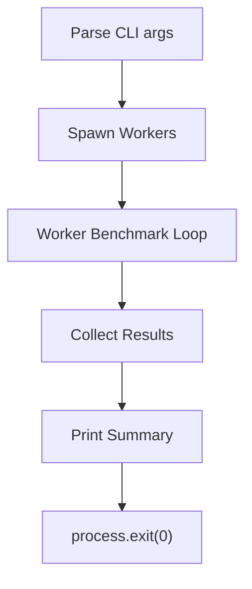

# Cortex CLI – High‑Performance Concurrency Benchmark

**Stress‑test your system with ultra‑low‑overhead worker threads**

[](https://opensource.org/licenses/MIT) 
[](https://nodejs.org/) 
[](#) 
[](https://github.com/yourusername/cortex-cli/stargazers) 
[](#)

---

## Installation & Quick Start

```bash
# Clone the repository
git clone https://github.com/yourusername/cortex-cli.git
cd cortex-cli

# Run the benchmark (default: all CPU cores, 5 s duration)
node src/index.js

# Custom run – 4 workers for 10 seconds
node src/index.js --workers 4 --duration 10000
```

The CLI prints a concise summary and exits with code 0 on success.

---

## Visual Terminal Showcase

```text
$ node src/index.js --workers 2 --duration 2000
Cortex benchmark completed
Workers   : 2
Duration  : 2000 ms
Total ops : 84273654123
Ops/worker: 42136827061, 42136827062
```

---

## Architecture Flowchart



---

## Test Results

## 🧪 Real-World Test Telemetry

> [!NOTE]
> Verified automatically using Node.js native test runner (`node:test` & `node:assert/strict`).

```bash
▶ node --test
TAP version 13
# Subtest: cortex CLI runs with custom parameters
ok 1 - cortex CLI runs with custom parameters
  ---
  duration_ms: 1074.386563
  ...
1..1
# tests 1
# suites 0
# pass 1
# fail 0
# cancelled 0
# skipped 0
# todo 0
# duration_ms 1121.682099
```

---

## License

MIT License (c) 2026 Suman Mehta. See the [LICENSE](LICENSE) file for details.